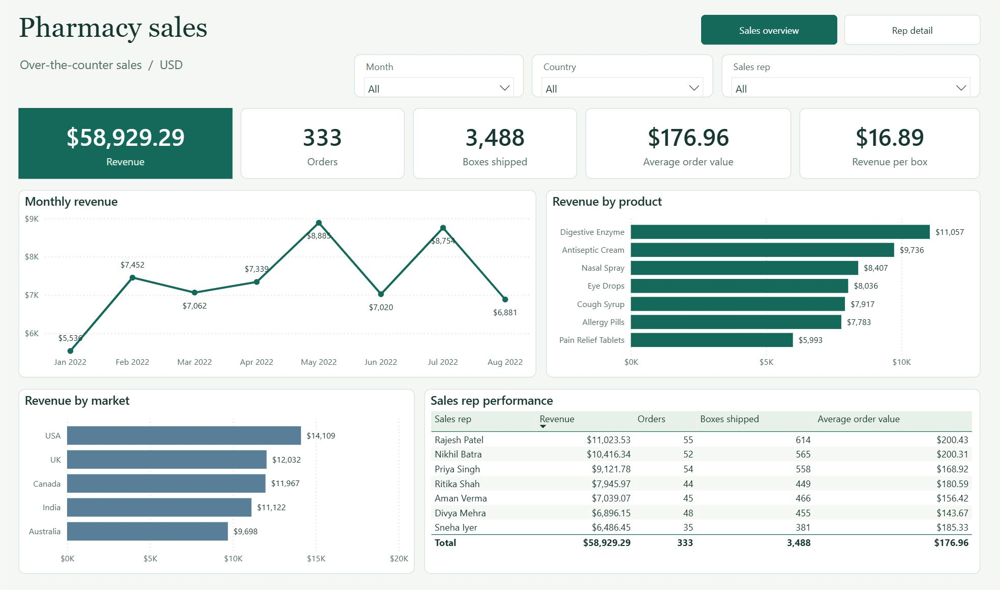
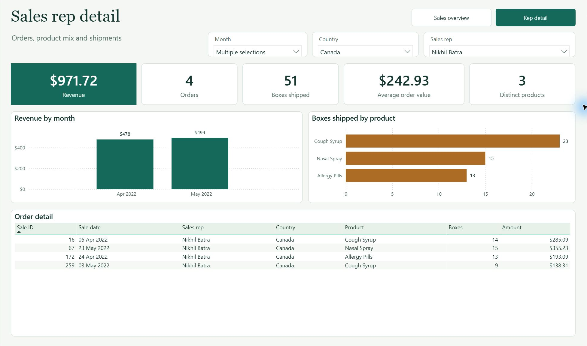

# Over-the-counter pharmacy sales

A Power BI report for a sales manager reviewing a simulated over-the-counter pharmacy portfolio. It follows 333 transactions across seven products, seven sales reps and five countries from January through August 2022. Each source row represents one sale. Revenue is the recorded transaction amount in USD.

[Download the Power BI report (.pbix)](https://github.com/aymaneben595/Pharma-Sales-Analytics-Dashboard/raw/refs/heads/main/Power%20Bi/OTC%20Sales.pbix) · [Browse the Power BI project files](Power%20Bi)

Open the downloaded report in Power BI Desktop to explore the included data. To edit the project as source files, clone the repository and open `Power Bi/OTC Sales.pbip` alongside its report and semantic model folders.



## What drove sales?

- The portfolio generated **$58,929.29** and shipped **3,488 boxes**. The average order was **$176.96**.
- **May** led at **$8,885.00**, followed by July at **$8,754.44**. January was the smallest month at **$5,536.39**. The dataset covers eight months, so a year-over-year seasonality conclusion would need more history.
- **Digestive Enzyme** led both revenue and volume with **$11,056.61** and **612 boxes**. The **USA** led markets at **$14,109.48**. **Rajesh Patel** led sales reps at **$11,023.53**.

## Explore a sales rep

Choose **Rep detail** and use the month, country and rep selectors. You can also right-click a rep in the overview table and drill through. Both pages calculate from the same transaction table. Revenue sums the selected rows, orders counts them, and distinct products counts unique product names.



| Selection | Revenue | Orders | Boxes | Distinct products | Average order |
|---|---:|---:|---:|---:|---:|
| All transactions | $58,929.29 | 333 | 3,488 | 7 | $176.96 |
| Nikhil Batra · Canada · April and May 2022 | $971.72 | 4 | 51 | 3 | $242.93 |

## Corrections to the earlier project

| Earlier behavior | Correction |
|---|---|
| The detail revenue card used the one-row KPI export and repeated the company total after filtering. The product card used a transaction count. | DAX measures sum transaction amounts and count distinct products within the active filters. The four rows shown above include two Cough Syrup orders. |
| The written summary identified August as the peak and February as the low. | The overview and the findings above use the eight monthly totals recalculated from individual sales. |
| SQL created views in `analytics`, while Python tried `public` and then an unqualified lookup. Failed queries could produce empty CSVs and a success message. | The loader creates the schema, imports the local CSV and reads qualified views. An invalid or empty import rolls back. The stable export is replaced only after a successful run. |
| The medium sales-value band ended at $999 and the low band ended at $499. Amounts such as $499.50 fell into the smallest band. | The bands use descending lower bounds of $1,000, $500 and $100, including amounts with cents. |

## Rebuild the data

The standalone report includes its data. To refresh from a new export, use a dedicated PostgreSQL database for this project. The pipeline replaces the contents of `analytics.sales_data` on each successful full load. It also maintains the summary views for the Python exports.

1. Install the Python dependencies with `python -m pip install -r requirements.txt`.
2. Copy `.env.example` to `.env` and set the database, username, password, host and port for your local instance. The database role needs permission to create the `analytics` schema and its tables and views.
3. From the repository root, run the following command. To use a replacement CSV with the same header, add `--source "path/to/sales.csv"`.

```powershell
python ".\VSCode, SQL & Python\Python\etl_pipeline.py"
```

4. In Power BI Desktop, open **Transform data → Edit parameters**. Set **SalesCsvPath** to the full path of the generated `sales_current.csv` and refresh. The default output folder is `VSCode, SQL & Python/Python/outputs`. An empty parameter uses the included, verified portfolio snapshot.

The import was checked in an isolated PostgreSQL 18 database, including a repeat load and a deliberately invalid quantity. The failed load preserved the prior 333 rows. The two selections in the table above were also checked in Power BI Desktop.

[Source transactions](VSCode%2C%20SQL%20%26%20Python/CSV/pharmacy_otc_sales_data.csv) · [SQL transformations](VSCode%2C%20SQL%20%26%20Python/SQL/etl_customers.sql) · [Python loader](VSCode%2C%20SQL%20%26%20Python/Python/etl_pipeline.py) · [Power BI measures](Power%20Bi/OTC%20Sales.SemanticModel/definition/tables/Sales.tmdl)

Project by Aïmane Benkhadda.
